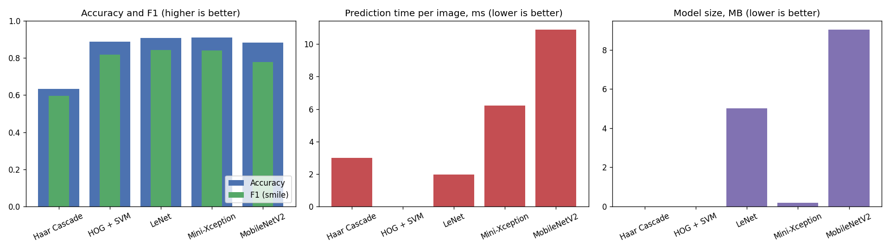
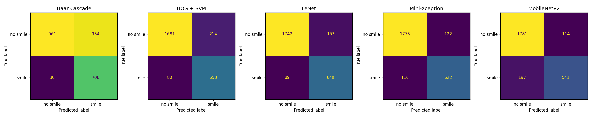
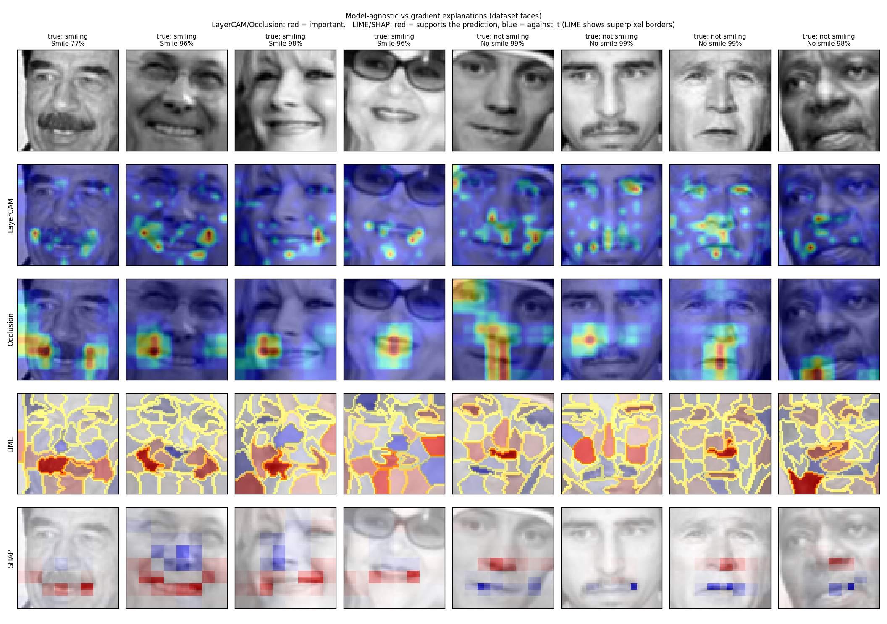
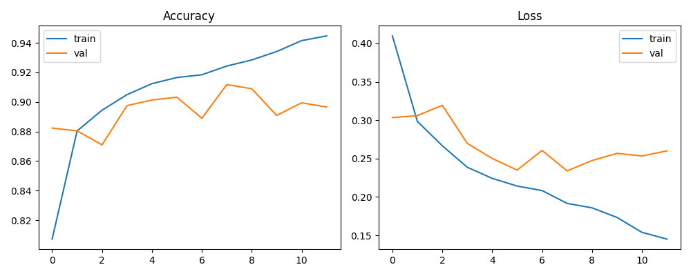

# Real-Time Smile Detection and Auto Capture with a LeNet CNN and Explainability AI Analysis

A real-time system that **automatically takes a selfie when you smile**.
OpenCV's Haar cascade finds the face, and a LeNet convolutional neural network decides whether it is smiling. The selfie is saved after the smile is held for 5 frames.
**LayerCAM heatmaps** show live which part of the face drove each decision.

**Live demo:** a screen recording of the live system (real-time detection, auto-capture, LayerCAM heatmaps) is available on request.

**Tools and technologies:** Python, OpenCV, TensorFlow/Keras, CNN (LeNet), explainable AI (Grad-CAM, LayerCAM, LIME, SHAP), Haar Cascade, scikit-learn, image processing

### Features
- Real-time smile detection with auto-capture (5-frame smoothing and 3-second cooldown)
- **Explainability** with 5 methods (Grad-CAM, LayerCAM, occlusion, LIME, SHAP) and a faithfulness check; LayerCAM runs live (`g`)
- **Built-in recording** of the app window to a browser-ready MP4 (`r`)
- Works on the webcam or on a **video file** (`--video clip.mp4`)
- Benchmark of 5 approaches, from classic computer vision to transfer learning

---

## Results

The final LeNet model reaches **90.8% accuracy** and **F1 0.844** (smile class) on 2,633 unseen test faces.

| Metric (final model, threshold 0.5) | Smiling | Not smiling |
|---|---|---|
| Precision | 0.805 | 0.954 |
| Recall | 0.888 | 0.916 |
| F1 | 0.844 | 0.935 |

### Benchmark: 5 approaches on the same split

| Model | Accuracy | F1 (smile) | Parameters |
|---|---|---|---|
| Mini-Xception | 91.0% | 0.839 | 50K |
| **LeNet (used in the app)** | **90.8%** | **0.843** | 1.25M |
| HOG + Linear SVM | 88.8% | 0.817 | 1.8K |
| MobileNetV2 (frozen, ImageNet) | 88.2% | 0.777 | 2.26M |
| Haar smile cascade (no training) | 63.4% | 0.595 | – |




**Key findings**
- **LeNet and Mini-Xception are tied** (~91%). Their order flipped between two benchmark runs, so the difference is within run-to-run noise. LeNet is used in the live app (simple, fast on CPU); Mini-Xception reaches the same accuracy with **25× fewer parameters** and would suit mobile devices.
- **Different models make different mistakes.** LeNet leans towards "smile" (153 false smiles vs 89 missed); MobileNetV2 is cautious and misses many smiles (197); the Haar smile cascade calls half of all non-smiling faces "smiling" (934 of 1,895).
- **Transfer learning was not automatically better.** Frozen MobileNetV2 features (learned on ImageNet colour photos) transferred poorly to small 64×64 grayscale faces.
- **Label noise:** many of the model's most confident "mistakes" are mislabelled dataset faces (clear smiles labelled *not smiling* and vice versa), so part of the measured error comes from the labels.

### Decision threshold

| Threshold | Precision (smile) | Recall (smile) | F1 |
|---|---|---|---|
| 0.5 | 0.805 | 0.888 | 0.844 |
| 0.7 | 0.869 | 0.847 | 0.858 |
| **0.8 (app)** | **0.894** | **0.791** | 0.840 |
| 0.9 | 0.930 | 0.703 | 0.801 |

The app uses **0.8**: an unwanted photo (false smile) is worse than waiting a moment for a clearer smile. Precision rises from 80.5% to 89.4%, and the 5-consecutive-frames rule compensates for the lower recall.

---

## Explainability: where does the model look, and can we trust the explanation?



Five methods show which part of the face drove each decision:

| Method | Type | How it works |
|---|---|---|
| **Grad-CAM** | Gradient (white-box) | One importance weight per feature map of the last conv layer (averaged gradient) |
| **LayerCAM** (used live) | Gradient (white-box) | An importance weight for **every position** (positive gradients × activations) |
| **Occlusion** | Model-agnostic | Covers a small patch at every position and measures how much the prediction drops |
| **LIME** | Model-agnostic | Hides random combinations of ~40 **superpixels** and fits a linear model to the results |
| **SHAP** | Model-agnostic | **Shapley values**: each region's fair average contribution; positive and negative evidence that adds up to the prediction |

**Step 1: direct evidence (region test, 473 confident smiles).** Covering the mouth region drops the average smile probability from **0.96 to 0.21**, while covering the forehead, eyes or nose changes it by at most 0.04. The model relies on the mouth.

**Step 2: faithfulness check.** Share of each method's positive evidence on the mouth region, for 40 confidently smiling faces (the mouth region is 32% of the image area):

| Method | Mouth region |
|---|---|
| Grad-CAM | 36% |
| LayerCAM | 55% |
| Occlusion | 68% |
| LIME | 69% |
| SHAP | 84% |

**Finding: classic Grad-CAM was the least faithful method for this model,** barely above an even spread The three model-agnostic methods (occlusion, LIME, SHAP: 68–84%) agree with the direct evidence; LayerCAM (55%) is in between.
The reason: LeNet uses **Flatten + Dense**, so every position in the feature map has its own weights. Grad-CAM averages the gradients over all positions and loses that spatial information. LayerCAM keeps a weight per position, and it's fast enough for live video, which is why it's used in the live app.

```bash
python gradcam.py --region-test          # step 1: cover face regions
python explain.py --faithfulness         # step 2: compare all 5 methods
python explain.py                        # comparison figure -> explain_lime_shap.png
python gradcam.py                        # gradient methods only -> gradcam_examples.png
```

### Robustness check: lighting and occlusion

One person, one factor changed at a time:

| Condition | Smiling | Neutral |
|---|---|---|
| Normal lighting | Smiling 100% | Not smiling 97% |
| Strong side lighting | Smiling 98% | Not smiling 77% |
| Occlusion | Smiling 93% (mouth covered) | Not smiling 82% (eyes covered) |

All six predictions are correct. With the mouth covered, occlusion, LIME and SHAP all place the evidence on **both cheeks**: the model falls back on raised cheeks, a marker of genuine smiles. Under side lighting, LIME and SHAP show stronger pro-smile evidence on the shadowed lips of the neutral face, which explains its lower confidence.
*Qualitative check on one person; a systematic version would apply these changes to the whole test set.*

---

## How it works



### Training (`train_model.py`)
1. **Load** the SMILEsmileD dataset: 13,165 face images (3,690 smiling, 9,475 not smiling).
2. **Preprocess:** grayscale, resize to 28×28, scale pixels to 0–1.
3. **Split:** 72% train / 8% validation / 20% test (stratified).
4. **Augment:** add a horizontally flipped copy of every training image.
5. **Handle class imbalance** with class weights (smiling ≈ 1.78, not smiling ≈ 0.70).
6. **Train LeNet** (Conv 20 → Pool → Conv 50 → Pool → Dense 500 + Dropout → Softmax) with the Adam optimizer and cross-entropy loss.
7. **Early stopping** on validation loss (keeps the best epoch) and **learning-rate reduction** on plateau.
8. **Evaluate once** on the untouched test set.

### Live detection (`smile_selfie.py`)
1. Read a webcam frame.
2. Find faces with the **Haar cascade** (`haarcascade_frontalface_default.xml`).
3. **Tight-crop** the face so it matches the training framing (see below).
4. Preprocess exactly like training (grayscale, 28×28, ÷255).
5. LeNet outputs a smile probability. At 80% or above, the face counts as smiling (green box).
6. After **5 smiling frames in a row**, save the clean frame to `selfies/`. A 3-second cooldown prevents duplicates.


---


## How to run

### 1. Install
```bash
pip install -r requirements.txt
```
> Use `opencv-python` version 4 (not 5, and not the `-headless` package), otherwise the Haar cascade files or the camera window won't load.

### 2. Run the live selfie app (trained model included)
```bash
python smile_selfie.py                    # webcam
python smile_selfie.py --video clip.mp4   # or a video file
python smile_selfie.py --model other.h5   # use a different trained model
```
Smile at the camera and the selfie is saved in `selfies/`.

| Key | Action |
|---|---|
| `g` | Show or hide the LayerCAM heatmap on each face |
| `r` | Start or stop recording the window to `recordings/demo_<time>.mp4` (H.264) |
| `q` | Quit |

### 3. (Optional) Train the model yourself
Download [SMILEsmileD](https://github.com/hromi/SMILEsmileD) and arrange it like this:
```
dataset/
    smiling/       ← SMILEs/positives/positives7
    not_smiling/   ← SMILEs/negatives/negatives7
```
Then run:
```bash
python train_model.py      # creates smile_lenet.h5 and training_plot.png
python compare_models.py   # optional: model comparison (results.csv + charts)
```
Or open `Smile_Selfie_Colab.ipynb` in Google Colab with a GPU. It downloads the dataset and runs everything for you.


### Training environment
- **Platform:** Google Colab, NVIDIA Tesla T4 GPU
- **Training time (benchmark run):** LeNet ≈ 18 s, Mini-Xception ≈ 99 s, MobileNetV2 ≈ 98 s
- **Live app:** runs on an ordinary laptop **CPU**; no GPU needed for real-time detection.
  
---

## Settings you can change (`smile_selfie.py`)

| Setting | Default | Effect |
|---|---|---|
| `SMILE_THRESHOLD` | 0.80 | Confidence needed to count as a smile |
| `SMILE_FRAMES` | 5 | Smiling frames in a row before capture |
| `COOLDOWN` | 3 | Seconds between two selfies |

---
  
## Use cases

It detects a smile as a **visible facial expression** and uses it as a **trigger**.
It does not infer emotions or evaluate people.

**Intended use cases**
1. **Hands-free selfies and self-portraits:** a smile replaces the shutter button or self-timer.
2. **Accessibility:** a smile-activated shutter for people who find it hard to press a button.
3. **Event photo booths:** automatic photos at parties, student events, conferences or weddings.
4. **Group photos:** capture the moment everyone is smiling (planned: "all faces smiling" mode).
5. **AI education and outreach:** visitors smile and watch the live LayerCAM heatmap show where
   the model looks, a hands-on introduction to computer vision and explainable AI.
6. **Teaching explainability:** the benchmark and faithfulness analysis are a compact case study
   of how to test whether an explanation method is trustworthy.
7. **Base for other face-attribute triggers:** the same pipeline can be retrained for other
   visible cues, e.g. eyes open/closed for "no blinking" photos.


---

## Conclusion

GrinCam shows that a small CNN can detect smiles reliably in real time, and that its
decisions can be explained and verified.

**1. Performance.** The LeNet-style CNN reaches **90.8% accuracy** and **F1 0.844**
(smile class) on 2,633 unseen test faces, despite a 2.6 : 1 class imbalance. Class weights,
flip augmentation and early stopping kept training stable.

**2. A small CNN is enough, and newer is not automatically better.** In a benchmark of five
approaches, LeNet (90.8%) and Mini-Xception (91.0%) were tied within run-to-run noise, ahead
of HOG + SVM (88.8%) and frozen MobileNetV2 (88.2%). The classic Haar smile cascade failed
(63.4%). Frozen ImageNet features transferred poorly to small grayscale faces.

**3. Deployment needs more than accuracy.** A train–deployment mismatch in face cropping caused
confident wrong predictions on real photos; matching the crop to the training framing fixed it
without retraining (1% → 99% on a smiling photo). A 0.80 decision threshold raises smile
precision from 80.5% to 89.4%, and a 5-frame rule prevents accidental captures.

**4. The model relies on the right features, and explanations must be verified.** Covering the
mouth lowers the smile probability from **0.96 to 0.21**, while other face regions change it by
at most 0.04. Model-agnostic methods agree (mouth region: occlusion 68%, LIME 69%, SHAP 84%),
but **Grad-CAM was the least faithful method** (36%, barely above an even spread of 32%),
because LeNet's Flatten + Dense layers make importance position-specific. LayerCAM (55%) was
therefore used in the live app. When the mouth is covered, the model falls back on raised
cheeks, a marker of genuine smiles.

**5. Limitations.** Subtle closed-mouth smiles, beards covering the mouth corners, and strong
overhead lighting are the main failure cases; the Haar face detector only finds frontal faces.
Several of the most confident "errors" are mislabelled dataset faces, so label noise also limits
measured accuracy. At 28×28 input, heatmaps are coarse (14×14 grid).

**6. Future work.** Contrast normalisation (CLAHE) and brightness augmentation against lighting
shift, 64×64 input for subtle smiles, a fine-tuned modern backbone (MobileNetV3/V4), TensorFlow
Lite export for mobile, a more robust face detector (MediaPipe), and a fairness evaluation across
age, gender and skin tone.

---

## Dataset
SMILEsmileD data from https://github.com/hromi/SMILEsmileD
The dataset is not included in this repository; the notebook and scripts download it.


## Author 
Vigash kumar
